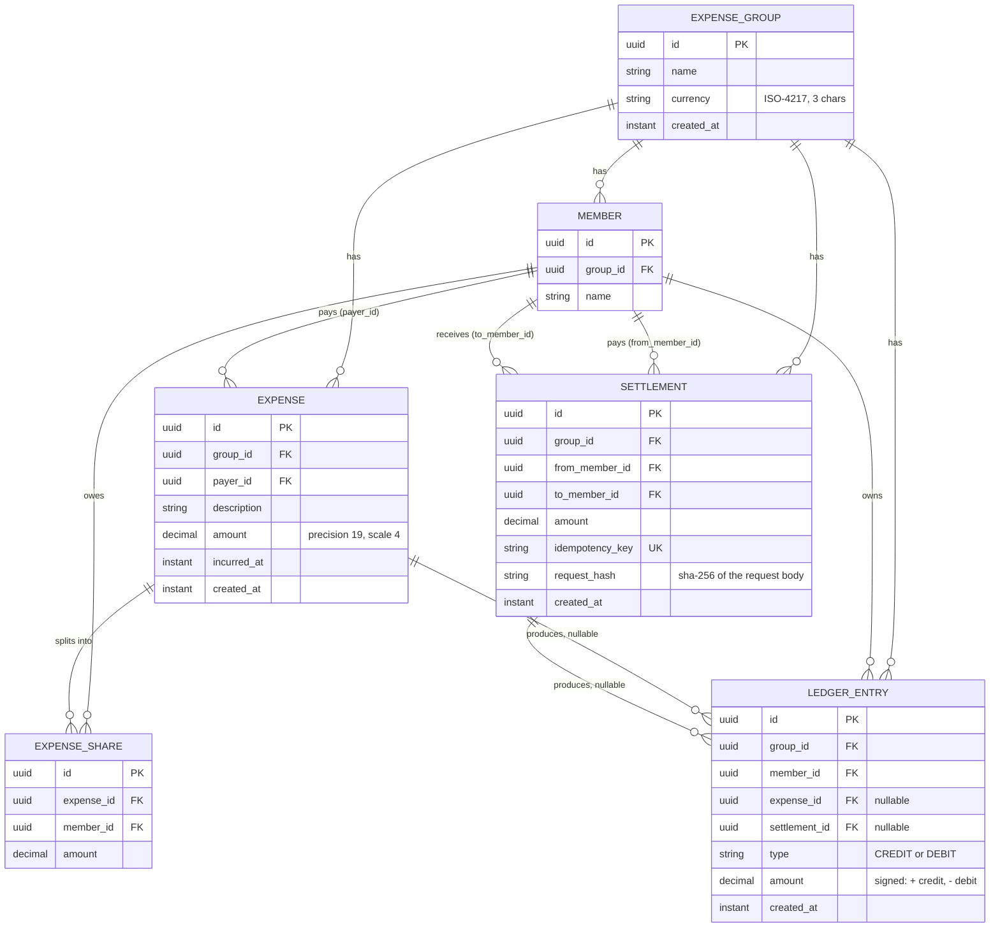

# Expense-Split Ledger

A group expense tracker built on a double-entry ledger. Balances are never stored — they are
derived from immutable ledger entries, so they reconcile by construction instead of being
recalculated and hoped over.


> **Status: M0–M9 complete, M10 in progress.** The REST API creates groups, posts expenses,
> returns balances derived from the ledger, settles debts behind an `Idempotency-Key` that
> survives retries and genuine concurrent duplicates, and suggests the payments that would
> clear a group (at most N − 1 for N members with a balance). **56 backend + 12 frontend
> tests** green, the backend against a real PostgreSQL 17 container including an invariant
> checked across 1,000 generated expenses, both run on every push by GitHub Actions. A React
> frontend (`frontend/`) drives the full flow: create a group, post an expense, watch balances
> update, settle a suggested transfer. Dockerized with Compose and deployed live on Render
> against a Supabase Postgres instance: **https://expense-split-ledger.onrender.com**. The
> frontend isn't deployed yet — that's the last piece of M10. See [Deploy](#deploy) and
> [Roadmap](#roadmap).

---

## Why a ledger instead of a balance column

The obvious design gives every group member a `balance` column and adds to it on each expense.
It works until it doesn't: a failed transaction leaves the column wrong with no record of what
it should have been, a retried request double-counts, and there is no way to answer "how did
this number get here?" The balance is an assertion nobody can verify.

Double-entry bookkeeping inverts that. Every expense writes a set of ledger entries that sum to
zero. Balances are a `SUM` over those entries, computed on read. A balance cannot drift from its
history, because it *is* its history — and the invariant `SUM(debits) = SUM(credits)` can be
asserted for any group at any point in time.

### A worked example

Alice pays ₹100 for a dinner shared equally by Alice, Bob and Carol. That writes four entries:

| Member | Entry  | Amount  | Why                                   |
|--------|--------|---------|---------------------------------------|
| Alice  | credit | ₹100.00 | She paid the bill; the group owes her |
| Alice  | debit  | ₹33.34  | Her own share                         |
| Bob    | debit  | ₹33.33  | His share                             |
| Carol  | debit  | ₹33.33  | Her share                             |

Credits total ₹100.00, debits total ₹100.00. The entries sum to zero, so the group's books
balance. Net position per member is a sum over their own rows:

```
Alice   +66.66      Bob   −33.33      Carol   −33.33      Total  0.00
```

₹100 divided three ways is ₹33.33 × 3 = ₹99.99. The remaining paisa is not dropped and not
allowed to float — it is assigned to a specific member by a deterministic, documented rule, so
the same expense always produces the same rows.

---

## What this project demonstrates

- **Double-entry bookkeeping** — every transaction writes balanced debit and credit rows, with
  the zero-sum invariant enforced and tested rather than assumed.
- **Idempotent settlements** — a settle-up carries an `Idempotency-Key`. A retry caused by a
  dropped response replays the original result instead of paying twice, including when the
  retry arrives while the first request is still in flight.
- **Correct money arithmetic** — `BigDecimal` throughout, with scale and `RoundingMode` fixed at
  defined boundaries and the remainder unit explicitly assigned rather than lost to rounding.
- **Settlement minimisation** — reducing N members with N mutual debts to a smaller set of M
  transfers, with the algorithm and its optimality bounds documented.
- **Property-based testing** — the ledger invariant is asserted across generated transaction
  sequences, not just hand-picked cases.

---

## Tech stack

| Layer     | Choice                                              |
|-----------|-----------------------------------------------------|
| Language  | Java 17                                             |
| Framework | Spring Boot 4.1.1 (Web MVC, Data JPA, Validation, Actuator) |
| Database  | PostgreSQL 17                                       |
| ORM       | Spring Data JPA / Hibernate                         |
| Testing   | JUnit 5, Testcontainers                             |
| Build     | Maven (via wrapper)                                 |

---

## Schema

Six tables. `ledger_entry` is the one that matters — every other table either produces its rows
(`expense`, `settlement`) or is who they're about (`expense_group`, `member`). No table stores a
balance; see [Why a ledger instead of a balance column](#why-a-ledger-instead-of-a-balance-column).



`LEDGER_ENTRY` is never updated or deleted — a correction is a new pair of entries, so the
history stays auditable. `expense_id` and `settlement_id` are mutually exclusive and both
nullable: every row was produced by exactly one of the two.

---

## Getting started

### Prerequisites

- JDK 17 or newer
- A container runtime — Docker or Podman
- No local Maven installation is required; the repository ships the Maven Wrapper

### Option A — Docker Compose (fastest)

```bash
docker compose up --build
```

Builds the app image, starts PostgreSQL, and waits for the database healthcheck before
starting the app. The API is on `localhost:8080` once `docker compose logs -f app` shows
`Started LedgerApplication`. Stop with `docker compose down -v` (the `-v` also drops the
Postgres volume, so the next `up` starts from an empty database).

Podman is a drop-in substitute: `podman compose up --build`.

### Option B — run the app from source, against a container database

#### 1. Start PostgreSQL

```bash
docker run -d --name ledger-pg -p 5432:5432 \
  -e POSTGRES_PASSWORD=ledger -e POSTGRES_DB=ledger \
  postgres:17
```

Podman is a drop-in substitute — replace `docker` with `podman` and use the fully qualified
image name `docker.io/library/postgres:17`.

#### 2. Run the application

```bash
./mvnw spring-boot:run
```

The application starts on port 8080 and creates its schema on first run.

#### 3. Verify

```bash
curl -s localhost:8080/actuator/health | python3 -m json.tool
```

A healthy instance reports the database component explicitly:

```json
{
  "status": "UP",
  "components": {
    "db": {
      "status": "UP",
      "details": { "database": "PostgreSQL", "validationQuery": "isValid()" }
    }
  }
}
```

A bare `{"status":"UP"}` is not sufficient — an application with no database at all returns the
same thing. The `db` component is what distinguishes *started* from *connected*.

### Option C — the frontend

With the API running on `localhost:8080` (either option above):

```bash
cd frontend
npm install
npm run dev
```

Opens on `localhost:5173`. The backend's CORS config (`app.frontend-origin`) allows that
origin by default — see [Configuration](#configuration) if you run the frontend elsewhere.

---

## Configuration

| Property                         | Default                                  | Notes                                     |
|----------------------------------|------------------------------------------|-------------------------------------------|
| `spring.datasource.url`          | `jdbc:postgresql://localhost:5432/ledger` | Reads `SPRING_DATASOURCE_URL`; falls back for local dev |
| `spring.datasource.username`     | `postgres`                               | Reads `DB_USERNAME`; Supabase's pooler username includes a project ref (`postgres.<ref>`) |
| `spring.datasource.password`     | `${DB_PASSWORD:ledger}`                  | Reads `DB_PASSWORD`; falls back for local dev |
| `spring.jpa.hibernate.ddl-auto`  | `update`                                 | Development convenience; not for production |
| `spring.jpa.open-in-view`        | `false`                                  | Disabled so lazy-loading faults surface in tests |
| `app.frontend-origin`            | `http://localhost:5173`                  | Reads `FRONTEND_ORIGIN`; the one origin the API's CORS config allows |

Override any of these with an environment variable rather than editing the committed file, for
example `DB_PASSWORD=… ./mvnw spring-boot:run`.

The frontend has its own `VITE_API_BASE_URL` (default `http://localhost:8080`), read at build
time — set it in `frontend/.env` or the environment before `npm run build`.

---

## Testing

```bash
./mvnw test
```

Integration tests run against a real PostgreSQL instance started by Testcontainers, not an
in-memory substitute — the ledger's constraints and `NUMERIC` semantics are database behaviour,
and H2 does not reproduce them faithfully.

<details>
<summary><b>Running the tests under Podman</b></summary>

Testcontainers is a Docker API client and does not detect Podman on its own. Expose Podman's
Docker-compatible socket and point Testcontainers at it:

```bash
systemctl --user enable --now podman.socket
export DOCKER_HOST=unix:///run/user/$(id -u)/podman/podman.sock
export TESTCONTAINERS_RYUK_DISABLED=true
```

`TESTCONTAINERS_RYUK_DISABLED` is required because Ryuk, the resource-reaper sidecar, needs
privileges that rootless Podman does not grant. With it disabled, containers from an
interrupted test run may need clearing manually via `podman ps -a`.

On an 8GB machine running other containers or processes at the same time, a second
Testcontainers Postgres starting mid-suite can occasionally fail with a "Broken pipe" from
Podman's API socket — a resource-pressure flake, not a test failure. Re-run; CI (GitHub
Actions, dedicated resources) is the authoritative signal either way.

</details>

```bash
cd frontend
npm test
```

Runs the Vitest suite (jsdom, no real backend — every `fetch` call is mocked).

---

## Deploy

The app deploys as a container to [Render](https://render.com)'s free web-service tier, against
a [Supabase](https://supabase.com) free Postgres database rather than Render's own — Render's
free-tier databases expire and are deleted after 30 days, which would kill a link a recruiter
clicks on in month two. Supabase's free Postgres project does not expire.

`render.yaml` in the repo root is a [Render Blueprint](https://render.com/docs/blueprint-spec)
with two services: a Docker web service for the API, built from the committed `Dockerfile`
with `SPRING_DATASOURCE_URL`, `DB_USERNAME` and `DB_PASSWORD` left unset (`sync: false`) so no
credential is committed; and a static site for `frontend/`, built with `npm install && npm run
build` and served from `frontend/dist`.

1. Create a free Supabase project. From its dashboard, **Connect** → copy the **Transaction
   pooler** connection string (port 6543) — direct connections aren't reachable from Render's
   network. Note the host, the pooler username (`postgres.<project-ref>`), and the database
   password you set at project creation.
2. On Render: **New** → **Blueprint**, point it at this GitHub repo. Render reads `render.yaml`
   and proposes both services.
3. Before the first deploy, set the three API environment variables:
   - `SPRING_DATASOURCE_URL` = `jdbc:postgresql://<pooler-host>:6543/postgres`
   - `DB_USERNAME` = `postgres.<project-ref>`
   - `DB_PASSWORD` = the Supabase project password
   `FRONTEND_ORIGIN` (on the API) and `VITE_API_BASE_URL` (on the static site) are already set
   in `render.yaml` to each other's expected `*.onrender.com` URL — correct as long as the
   service names in the Blueprint proposal match `render.yaml`'s `name:` fields; if Render
   suffixes either name to avoid a collision, update the other service's env var to match
   before the first deploy.
4. Deploy. `spring.jpa.hibernate.ddl-auto=update` creates the schema on first boot. Verify the
   API with `curl -s https://<api-service>.onrender.com/actuator/health` — look for `"db":
   {"status": "UP"}` exactly as in [Verify](#3-verify) above — and the frontend by opening its
   URL and creating a group.

Render's free web services spin down after 15 minutes idle and cold-start in a few seconds on
the next request — expected, not a bug. Render's free static sites don't spin down.

---

## Roadmap

**Stage one — core ledger**

- [x] **M0** — Project scaffold, PostgreSQL connection, `/actuator/health` reporting `db: UP`
- [x] **M1** — Domain model: `Group`, `Member`, `Expense`, `ExpenseShare` with JPA mappings
- [x] **M2** — `LedgerEntry` and expense posting, with debits equal to credits after every post
- [x] **M3** — REST API: create group, add expense, read derived balances; DTOs and centralised error handling

**Stage two — correctness and scale**

- [x] **M4** — Settlements with `Idempotency-Key`, stored request hash and replayed responses
- [x] **M5** — `BigDecimal` audit: scale, rounding mode and deterministic remainder assignment
- [x] **M6** — Settlement minimisation, N members reduced to M transfers
- [x] **M7** — Generated-sequence invariant test grown to 1,000 expenses; GitHub Actions CI running the suite on every push
- [x] **M8** — Schema diagram, `compose.yaml`, and a live backend deploy: Render running the Dockerized app against a Supabase Postgres instance, `/actuator/health` reporting `db: UP`

**Stage three — frontend**

- [x] **M9** — React frontend: create a group, post an expense, view derived balances
- [ ] **M10** — Settle-up flow in the UI, PR #1 merged to `main`, frontend deployed alongside the API

---

## API

Three endpoints carry the core ledger. Every response is a DTO — entities are never serialised.

| Method | Path | Does |
|---|---|---|
| `POST` | `/api/groups` | Create a group with its members |
| `POST` | `/api/groups/{id}/expenses` | Post an expense, split equally |
| `GET`  | `/api/groups/{id}/balances` | Net position per member, derived from the ledger |
| `POST` | `/api/groups/{id}/settlements` | Settle a debt between two members; requires an `Idempotency-Key` header |
| `GET`  | `/api/groups/{id}/settlements/suggested` | The payments that would clear the group, at most N − 1 for N members with a balance. Read-only |

### The worked example, end to end

```bash
GROUP=$(curl -s -X POST localhost:8080/api/groups \
  -H 'Content-Type: application/json' \
  -d '{"name":"Goa trip","currency":"INR","members":["Alice","Bob","Carol"]}')

GID=$(echo "$GROUP" | python3 -c 'import sys,json;print(json.load(sys.stdin)["id"])')
AID=$(echo "$GROUP" | python3 -c 'import sys,json;print(json.load(sys.stdin)["members"][0]["id"])')

curl -s -X POST localhost:8080/api/groups/$GID/expenses \
  -H 'Content-Type: application/json' \
  -d "{\"payerId\":\"$AID\",\"description\":\"Dinner\",\"amount\":100.00}"

curl -s localhost:8080/api/groups/$GID/balances | python3 -m json.tool
```

Alice paid ₹100 for three people, so the balances come back as the README promised — and the
stray paisa is assigned, not dropped:

```json
{
  "balanced": true,
  "balances": [
    { "memberName": "Alice", "amount":  66.66 },
    { "memberName": "Bob",   "amount": -33.33 },
    { "memberName": "Carol", "amount": -33.33 }
  ]
}
```

`balanced` is not decoration. It re-sums every ledger row for the group and asserts the total is
zero, so the response says whether the books actually reconcile at the moment you read them.

### Errors

One `@RestControllerAdvice` turns every failure into the same JSON shape.

| Case | Status |
|---|---|
| Bean-validation failure (negative amount, malformed currency) | `400` |
| Missing `Idempotency-Key` header on a settlement | `400` |
| Unknown group | `404` |
| Broken invariant (payer outside the group, shares that do not reconcile, settling with yourself, an amount with more than 2 decimal places) | `422` |
| `Idempotency-Key` reused with a different request body | `409` |

```json
{ "error": "Not Found", "message": "no such group: 5077d9c7-…", "timestamp": "2026-09-16T05:14:47Z" }
```

A rejected invariant is the caller's mistake, not a server fault, so it is `422` rather than `500`.

---

## Project structure

```
src/main/java/com/swayam/ledger/
├── LedgerApplication.java
└── …                           domain, ledger, web and service packages land here

src/test/java/com/swayam/ledger/
├── LedgerApplicationTests.java
├── TestcontainersConfiguration.java   PostgreSQL container wired via @ServiceConnection
└── TestLedgerApplication.java         local entry point backed by Testcontainers

frontend/src/
├── api/              fetch wrapper (client.ts) and TypeScript types mirroring Dtos.java
└── components/       CreateGroupForm, ExpenseForm, BalancesView — each with a co-located test
```

`TestLedgerApplication` runs the application against a throwaway PostgreSQL container instead of
a local one, which is useful when the development database is not running.
